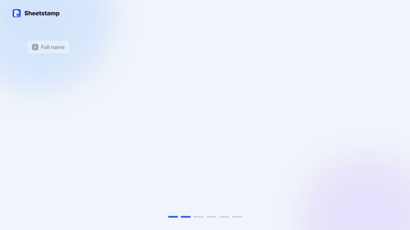
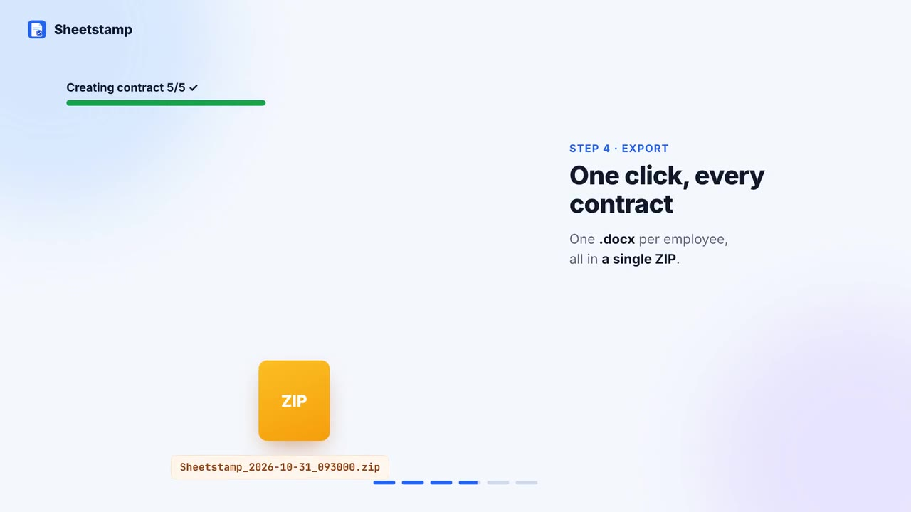
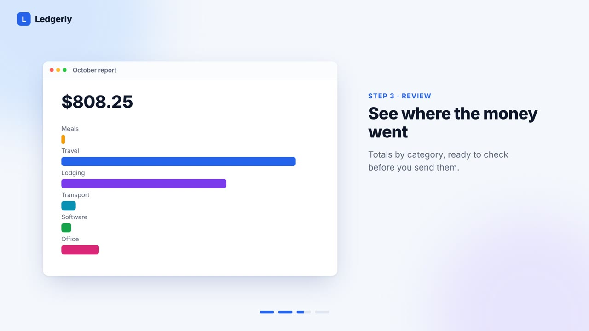
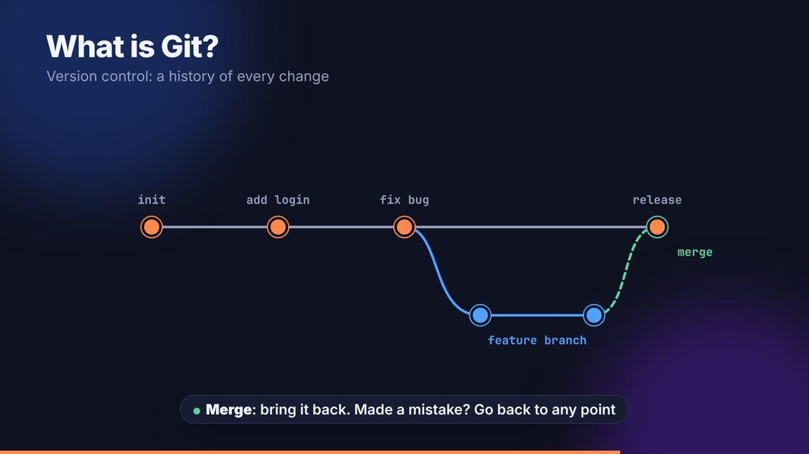
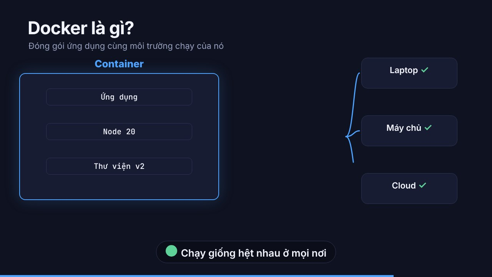
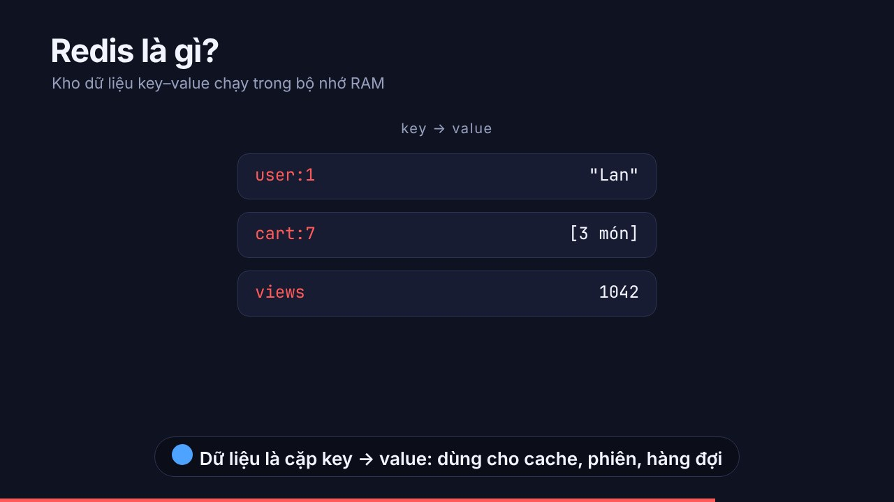
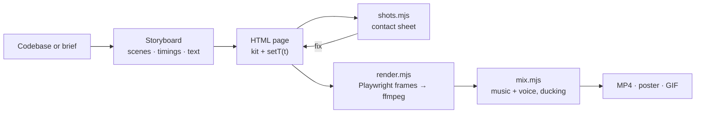

<div align="center">


# claude-veo

**Polished product demo and explainer videos, made by Claude Code from plain HTML.**

[](LICENSE)
[](https://github.com/nhhthong/claude-veo/actions/workflows/ci.yml)




</div>

Ask Claude Code for *"a 45-second demo of this app"* or *"a 15-second video: what is Redis?"*. It reads your project or your brief, writes a storyboard, builds every scene as an animated HTML mock with smooth transitions, dashed arrows and clean type, and renders a crisp MP4. No video editor, no screen recording, no stock footage.

## Gallery

| Product demo · Sheetstamp (49 s) | Template · Ledgerly (34 s) |
| :-: | :-: |
| [](media/sheetstamp-demo.mp4) | [](media/ledgerly.mp4) |
| Word template → Excel → match → ZIP → image cards · [source](examples/sheetstamp/demo.html) | Import → sort → report → export · [source](skills/video-engine/templates/product-demo.html) |

| Explainer · What is Git? | Explainer · Docker | Explainer · Redis |
| :-: | :-: | :-: |
| [](media/git.mp4) | [](media/docker.mp4) | [](media/redis.mp4) |
| [source](skills/video-engine/templates/explainer.html) | [source](examples/explainers/docker.html) | [source](examples/explainers/redis.html) |

Click a poster to open the MP4. The gallery videos are silent; music and voice-over are added per project.

## What you get

| Skill | Use it for |
|---|---|
| **`product-demo`** | Reads your codebase (README, docs, UI strings, routes, CLI help, e2e tests, fixtures), finds the main workflow and turns each step into a scene: a 35 to 55 s demo that shows what the tool *does*. |
| **`video-brief`** | Builds a video from your description: "what is X?" explainers, concept diagrams, announcements, tutorial steps, vertical social clips. |
| **`video-engine`** | The shared engine: a CSS/JS kit, two templates, and scripts to preview, render and mix sound. The other two skills use it. |

**The look**, built in: left visual and right explanation panel, a step tracker, drifting colour blobs, paper-white windows with soft shadows, dashed arrows that draw themselves, placeholders that morph into values, rows that slide in, numbers that count up, cards that fan out and fly into a file. Light and dark themes. See [`style.md`](skills/video-engine/references/style.md).

**The engine**, built for reliability:
- **Deterministic.** A video is one HTML page with `window.DURATION` and a pure `window.setT(t)`. Every render is identical and any frame can be inspected.
- **Fast feedback.** `shots.mjs` makes a contact sheet of chosen moments in seconds, before any rendering.
- **Parallel render.** `render.mjs --workers 4` rendered the 34 s 1080p template in about 75 s in our test environment.
- **Sound that sits right.** `mix.mjs` trims and fades music, places voice-over clips at their scene times and ducks the music under the voice.
- **Voice-over ready.** The skills write a timed script for ElevenLabs or any text-to-speech, one line per scene.

## Install

**As a plugin** (recommended), inside Claude Code:

```text
/plugin marketplace add nhhthong/claude-veo
/plugin install veo@veo-studio
```

The skills are then available as `/veo:product-demo`, `/veo:video-brief` and `/veo:video-engine`, and Claude also picks them up on its own when you ask for a video.

**As plain skills**: copy the three folders together (the two workflow skills use `../video-engine`):

```bash
git clone https://github.com/nhhthong/claude-veo
cp -r claude-veo/skills/* ~/.claude/skills/
```

### Requirements
- Node.js 18+
- [Playwright](https://playwright.dev) with Chromium: `npm i -D playwright && npx playwright install chromium`
- `ffmpeg` and `ffprobe` on `PATH`

## Usage

```text
> Make a 45-second English demo video of this app for the landing page hero.
> Make a 15-second explainer: what is Docker? Dark theme.
> Turn this feature list into a 25-second announcement video, 1080x1920 for social.
```

Claude shows a storyboard when choices are open, checks contact sheets as it builds, renders, and hands you the MP4, a poster frame, the HTML source and a voice-over script.

Run the engine yourself:

```bash
E=skills/video-engine
mkdir -p video && cp -r $E/kit video/ && cp $E/templates/product-demo.html video/demo.html
node $E/scripts/shots.mjs  video/demo.html video/sheet.jpg 2 7 13.5 20.5 26 32   # preview
node $E/scripts/render.mjs --html video/demo.html --out video/demo.mp4 --workers 4 --poster 20
node $E/scripts/mix.mjs    --video video/demo.mp4 --out video/final.mp4 --music music.mp3 \
                           --voice 0.3:vo/01.mp3 --voice 3.5:vo/02.mp3
```

## How it works



## Repository layout

```text
.claude-plugin/          plugin and marketplace manifests, icon
skills/
  product-demo/          read a project, make its demo video
  video-brief/           make a video from a description
  video-engine/          kit/ (veo.css, veo.js) · templates/ · scripts/ · references/
examples/                full source of the gallery videos
media/                   rendered gallery videos, posters and the preview GIF
```

## Good to know
- **Rights.** The skills never add music or images without rights you confirm. The gallery uses made-up data; the Sheetstamp example uses its own app icon and a card image supplied by its author.
- **Honesty.** The product skill only states features, platforms and numbers it finds in your project, and says what it checked (a contact sheet is not watching the whole video).
- **Fonts.** Inter and JetBrains Mono look best; the kit falls back to system fonts. Install them on the machine that renders.

## Contributing

Issues and pull requests are welcome. Keep the kit dependency-free, keep pages deterministic, and attach a contact sheet (`shots.mjs`) of any visual change.

## License

[MIT](LICENSE) © 2026 nhhthong
